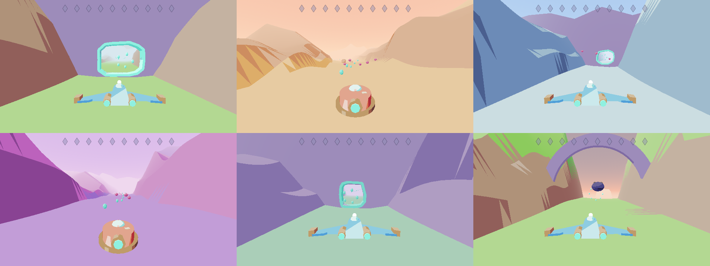
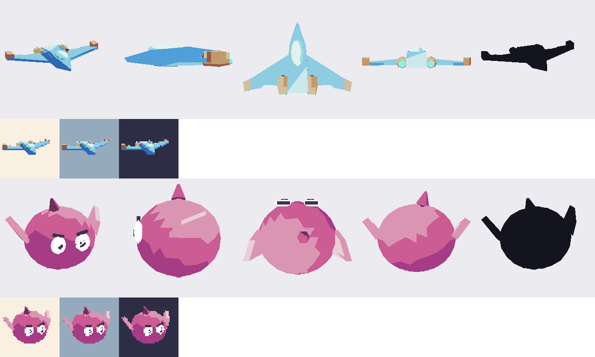

# Sky Skimmers

**A calm, wordless 3D rail-flying game for small children: you can't fail, can't lose, and need no reading.**

You fly a little skimmer ship through soft pastel canyons. You pop grumpy puff-critters, collect glowing orbs and thread through gaps in giant walls across the sky. At the end you wake the Sky Gate so the sun rises.



Every ship, critter, canyon, icon, sound effect and music loop is generated by a small set of **Python scripts**. They use geometry (Shapely + trimesh) and synthesis (NumPy). The repo contains no hand-made or third-party art or audio.

> "Sky Skimmers" is a working title.

---

## Made for a 4-year-old
- **No fail state.** Bumps are soft boops. Nothing is ever lost, and if the child stops steering the ship keeps flying.
- **No text.** Every menu is a big icon, and meaning comes from shape, colour, motion and sound.
- **Gentle on the body.** The horizon never rolls, there's no screen shake or flashing, speed changes are eased, and the pace is slow.
- **Invisible help.** If the child keeps bumping into things, the game quietly widens the help and slows down. It never gets harder because the child is doing well.
- **Button-mash proof.** Any unbound button just honks.
- **A grown-up menu**, hidden behind a 3-second hold, holds settings, controller setup, reset and quit (English and Spanish).

## Play
**Windows:** download `SkySkimmers.exe` from the [Releases](../../releases) page and double-click it. There's no install.
**Linux:** download `SkySkimmers.x86_64`, run `chmod +x` on it, then run it.

| | Keyboard | Gamepad |
|---|---|---|
| Steer | W A S D / arrows | left stick / d-pad |
| Fire (hold) | Space | A / Cross |
| Honk | H, or any other key | any other button |
| Pause | Esc | Start |
| Restart | R: tap = checkpoint, hold = level | pause menu ↻ |
| Speed | pause menu »» (cycles slow / medium / normal) | same |
| Grown-up menu | **hold F1 for 3 s**, or hold the ⚙ on the title | **hold Start + Select for 3 s** |

In hover levels, pushing up makes the ship **hop**. For unusual controllers such as a PS2-to-USB adapter, open the grown-up menu and choose **Set up a controller…**, then press each button when asked. The menu also shows live input values.

## Levels
| # | Level | Vehicle | Idea |
|---|---|---|---|
| 1 | Meadow Canyon | Kite (air) | learn to steer and fire; one huge gap |
| 2 | Sunrise Dunes | Sled (hover) | ride the dunes, hop over rocks |
| 3 | Cloud Ridge | Kite | three walls, each gap a bit smaller |
| 4 | Crystal River | Sled | narrow pink gorge, crystals, arches |
| 5 | Mist Peaks | Kite | floating islands, slowly sliding gaps |
| 6 | Sky Gate | Kite | the first canyon, giant-sized, at sunrise; the sleepy Guardian lights the Gate |

Each level takes about 3 minutes, with checkpoints along the way. A sticker book tracks finished levels and orbs and unlocks three ship colours.

---

## How it's made

```
tools/*.py ──► assets/*.glb, levels/*.json, assets/audio/*.wav, assets/ui/*.png ──► Godot 4 (GDScript) ──► one .exe
```

- **Geometry:** ships and critters are built from 2D silhouettes (Shapely). These are extruded, intersected, lathed and lofted with trimesh, then flat-shaded into one hue-shifted pastel palette as vertex colours. Textures aren't used anywhere.
- **Levels are data.** A spline rail plus a width/height profile produces a carved canyon ribbon with walls, gaps, rocks and islands. One generic loader in Godot plays any level JSON.
- **Audio:** sine voices, soft envelopes, low-pass filtering and a small reverb. The music is a pentatonic loop per level, an integer number of bars long so it loops seamlessly.
- **Checks:** budget, geometry and audio checks fail the build if anything is too heavy, too sharp, too narrow or too loud.
- **Test bots:** they play every level only through input actions. A "good pilot" follows the orbs; a "bad pilot" mashes at random. Both must finish every level.



## Build from source
Requirements: [Godot 4.7.2](https://godotengine.org/download) (as `godot` on PATH), Python 3.10+.

```bash
pip install shapely trimesh numpy scipy pillow mapbox_earcut manifold3d
python3 tools/build_all.py          # regenerate every asset, level and sound (+ budget/geometry/audio checks)
tools/run_tests.sh                  # import, compile check, input/save fuzz, bots on every level, screenshots
godot --path .                      # play from source
godot --headless --export-release "Windows" build/windows/SkySkimmers.exe   # needs export templates
```

Useful flags (after `--`): `--level=N` starts a level directly, `--bot=good|bad` runs an autopilot, `--shots` takes a screenshot tour, `--check` compile-checks all scripts, and `--test` runs the input/save self-test.

### Add a level
1. In `tools/levels.py`, add a `level_N()` function: rail control points, a corridor profile, walls with gaps, orbs and critters (using the `orb_line` / `orb_ring` / `group` helpers), and checkpoints. Then add it to `DEFS`.
2. Add a palette block in `tools/palette.py`.
3. Run `python3 tools/build_all.py`. The game picks the level up automatically.

### Project layout
```
tools/      Python generators, build_all.py, run_tests.sh
scripts/    systems/ (Save, Bindings, AudioBus, Game) · game/ (level runner, ship, enemy) · ui/
scenes/     title, level runner, sticker book, parent menu, ending
assets/     generated meshes, audio, icons, palette   levels/  generated level JSON
tests/      bot pilot                                   docs/    design, decisions, iteration log, screenshots
```

## Status and ideas
It's playable start to finish. Ideas for later:
- Hand-made props (birds, moss, an old crashed ship) and outlines.
- Richer, human-composed music.
- More critter behaviours.

The design notes and the full decision log are in [`docs/`](docs/).

## License & credits
- **Code and generated assets:** see [`LICENSE`](LICENSE).
- **Third-party components:** see [`LICENSES.md`](LICENSES.md).
- **Engine:** built with [Godot Engine](https://godotengine.org) (MIT).
